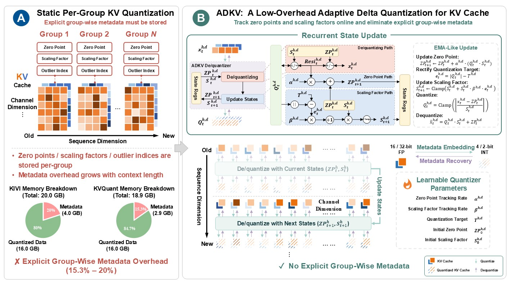

# [NeurIPS 2026] Official Repository for *"ADKV: A Low-Overhead Adaptive Delta Quantization for KV Cache in LLM Inference"*



**TL;DR:** ADKV is an adaptive delta quantization framework for KV cache that leverages EMA-like per-channel online tracking to embed metadata directly into the quantized sequence, reducing metadata overhead while preserving quantization accuracy.

**Abstract:** The KV cache is a major memory bottleneck in LLM inference, especially under large batch sizes and long contexts.
While quantization is a promising solution, existing static per-group quantization methods are constrained by a trade-off between metadata overhead and accuracy: increasing the group size reduces group-wise metadata (e.g., zero points, scaling factors, and outlier indices), but exacerbates quantization error under the sinusoidal-like temporal drift of post-RoPE outlier channels; conversely, using smaller groups improves accuracy but incurs substantial metadata overhead.
In this paper, we propose ADKV, a low-overhead adaptive delta quantization framework for KV cache in LLM inference, which leverages the temporal structure of the KV cache. 
ADKV tracks channel-wise zero points and scaling factors online via EMA, adapting to the sinusoidal-like temporal drift, thereby eliminating the rigidity of static per-group quantization.
This adaptive mechanism further enables delta coding to embed metadata implicitly into the quantized sequence, decoupling metadata overhead from context length.
To minimize the MSE of attention outputs, we design an SGD-based calibration algorithm that models ADKV as a recurrent computation graph.
Experiments on generation and long-context benchmarks demonstrate that ADKV reduces total KV cache memory by 5.87-19.99% and quantization metadata memory by 99.76-99.94% compared to the static per-group quantization baselines, while maintaining comparable accuracy.
On an NVIDIA L40 (48GB) GPU, a custom fused ADKV-GEMV CUDA kernel optimized for memory-bound autoregressive decoding achieves a 2X larger maximum feasible batch size, and 1.53X end-to-end throughput gain at a batch size of 128 over the baselines.

**Paper:** [ADKV Paper PDF](docs/paper.pdf)

## Requirements

First, install [pytorch](https://pytorch.org/get-started/locally/) according to your GPU environment.

Then, install the required dependencies:

```bash
pip install -r requirements.txt
```

## Calibration

### Collect a Calibration Set

As ADKV requires calibration, you need to collect a calibration set first.
Here is an example of collecting a calibration set from Llama-2 7B:

```bash
bash script/llama_collect_calib.sh
```

Once the process is complete, the calibration set will be available in the `calib/` folder.

### Calibrate ADKV

The calibration model for ADKV is defined in `src/adkv/train/train_model.py`.
Below is an example of calibrating ADKV with the calibration set:

```bash
bash script/llama_adkv_train.sh
```

Once the process is complete, the calibrated ADKV parameters will be available in the `calib/` folder.

## Evaluation

### Accuracy Evaluation

This work uses the `lm-eval` framework to evaluate several benchmarks, including `CoQA`, `TruthfulQA`, `GSM8K`, and others.
We provide a simple HF model, `src/adkv/hf/llama_adkv_eval.py`, implemented with Triton without complex CUDA details, which can help you understand the ADKV algorithm.
This model is also designed for accuracy evaluation.
Here is an example of benchmarking `winogrande`:

```bash
bash scripts/lm_eval_adkv.sh --task winogrande
```

Due to random initialization in the calibration process, the accuracy evaluation results may exhibit some fluctuation.

#### LongBench Evaluation

To accelerate LongBench evaluation, we implemented a parallel evaluation program using Ray.
Here is an example of benchmarking `narrativeqa`:

```bash
bash scripts/longbench_eval_adkv.sh --task narrativeqa
```

### CUDA Kernel Evaluation

The fused ADKV-GEMV CUDA kernels are defined in `src/adkv/kernel/gemv.cu`.
We provide a script for evaluating our fused ADKV-GEMV CUDA kernels:

```bash
bash scripts/perf_kernel.sh
```

### End-to-End Throughput Evaluation

We provide an HF model, `src/adkv/hf/llama_adkv.py`, implemented with the fused ADKV-GEMV CUDA kernels, which can help you understand how to integrate these kernels into an HF model.
We also provide a script for evaluating end-to-end throughput:

```bash
bash scripts/perf_e2e.sh
```

### Memory Savings Evaluation

We provide several accurate formulas for calculating ADKV memory savings:

```bash
bash memory_comparison_fig.sh
```

## Auxiliary Figures

We provide several scripts for generating the auxiliary figures in the paper.

Figure 2:

```bash
bash scripts/wtzp_wts_fig.sh
bash scripts/trace_fig.sh
bash scripts/comparison_adkv_fig.sh
```

Figure 6:

```bash
bash scripts/adkv_param_distribution_fig.sh
```

## Citation

We would appreciate it if you could cite the following paper if you find this paper useful for your work:

```bibtex
@inproceedings{jia2026adkv,
  title={ADKV: A Low-Overhead Adaptive Delta Quantization for KV Cache in LLM Inference},
  author={Jia, Honghao and Li, Zhenxing and Guo, Jialiang and Gan, Jiacheng},
  booktitle={Advances in Neural Information Processing Systems},
  year={2026}
}
```
